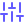
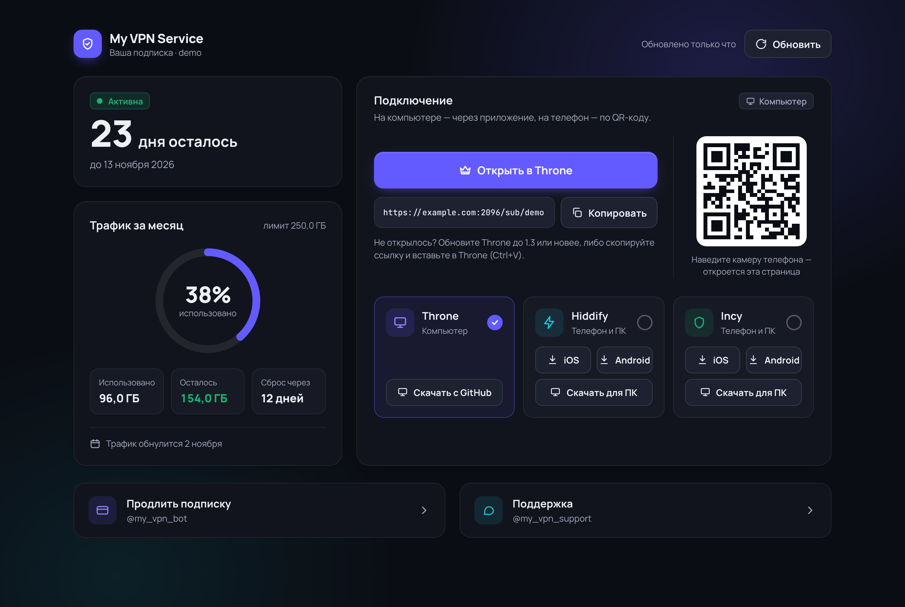
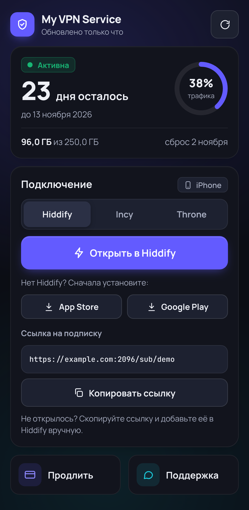
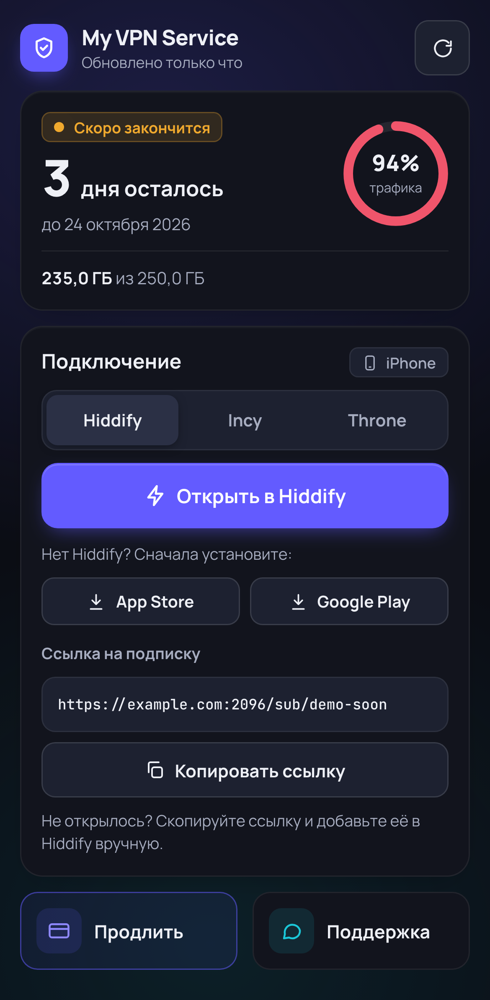
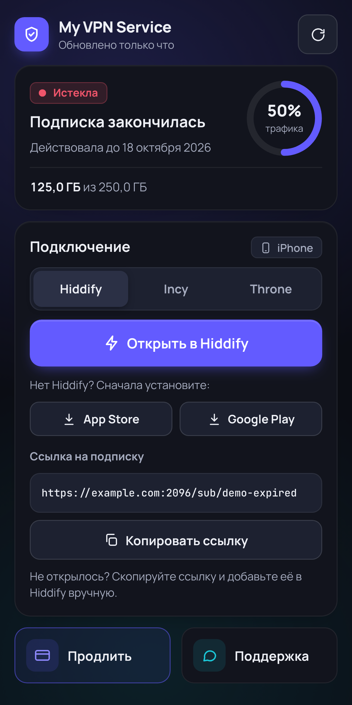

#  2S-UI-TGbot-Dashboard: Telegram-бот и веб-дашборд для панели 2S-UI

[](https://ubuntu.com/)
[](https://www.python.org/)
[](https://docs.aiogram.dev/)
[](https://fastapi.tiangolo.com/)
[](https://nginx.org/)
[-yellow.svg)](https://certbot.eff.org/)

Продажа и обслуживание VPN-подписок на панели **2S-UI** через Telegram: покупатель выбирает срок и присылает чек, администратор одной кнопкой подтверждает оплату, а бот сам создаёт или продлевает подписку в панели и присылает покупателю ссылку на личную страницу подключения.

Комплекс состоит из двух служб `systemd` (бот и веб-дашборд) с общей папкой, общим `venv` и одним файлом настроек `.env`. Ставится и обновляется одним скриптом.

> [!IMPORTANT]
> **Платёжного шлюза нет — оплату подтверждает администратор.** Всё остальное бот делает сам: создаёт клиента в панели через её REST API, продлевает срок, привязывает Telegram ID, напоминает об окончании подписки.  
> **Нужен API-токен панели** (Настройки панели → API-токены). Без него бот работает в ручном режиме: после подтверждения оплаты клиента создаёт администратор в панели.

Подробное техническое руководство — [docs/PROJECT_INSTRUCTIONS.md](docs/PROJECT_INSTRUCTIONS.md), справка по API панели — [docs/panel-api.md](docs/panel-api.md).

---

##  Как проходит покупка

**Покупатель**
1. «💳 Купить подписку» → выбирает срок: 30, 90, 180 или 365 дней. У длинных сроков показана цена за месяц, самый выгодный отмечен 🔥 и подписан «выгоднее всего» (цены и скидки — в `TARIFFS`).
2. Если у него уже есть подписка, бот спрашивает: «Продлить …» (срок добавится, ссылка не изменится) или «Новая подписка» (отдельная ссылка, например для других устройств). Из карточки подписки и из напоминаний продление открывается сразу для нужной подписки.
3. Видит реквизиты и три шага: перевести, прислать чек (фото или файл), дождаться проверки.
4. Получает сообщение «⏳ Заявка №… на проверке» — после решения администратора оно само меняется на «✅ выполнена» или «❌ отклонена».
5. После подтверждения приходит «🎉 Оплата подтверждена. Подписка … активирована до …» с кнопкой «🚀 Подключиться» — она открывает дашборд прямо в Telegram (Mini App).

**Администратор**
1. Получает чек с карточкой заявки: номер, тариф, сумма, новая подписка или продление, имя, Telegram ID — и кнопки «✅ Подтвердить» / «❌ Отклонить».
2. «✅ Подтвердить» → бот через API панели выдаёт подписку, подпись под чеком меняется на «✅ ВЫДАНО: имя до дата».
3. Если панель не ответила — под чеком появляется текст ошибки и кнопка «🔁 Повторить». Двойное нажатие или повтор не создадут вторую подписку: каждая заявка хранится в базе бота и обрабатывается один раз.
4. «❌ Отклонить» → покупатель получает сообщение, что оплата не подтверждена.

**Что бот записывает в панель**

| | Новая подписка | Продление |
|---|---|---|
| Имя клиента | случайные 8 символов (`a8Kd2mQx`) — оно же в ссылке | не меняется |
| Срок | сегодня + дни тарифа | текущий срок + дни тарифа (если истекла — от сегодня); клиент включается |
| `tgId` | Telegram ID покупателя — по нему бот находит подписку | записывается |
| Description | `tg://user?id=123456789 \| 123456789` — ссылка открывает профиль покупателя в Telegram и не ломается при смене юзернейма | обновляется, если там пусто, только ID или прежняя запись бота; ваши заметки не трогаются |
| Группа | `SUB_GROUP` (по умолчанию `buyer`) — купленные подписки видны в панели отдельно | ставится, только если у клиента нет своей группы |
| Входящие, ключи | `PANEL_INBOUND_IDS`, ключи для всех протоколов | не меняются |
| Лимиты | `SUB_TRAFFIC_GB` в месяц, `SUB_DEVICE_LIMIT` устройств | не меняются |
| Сброс трафика | `SUB_RESET_DAY_OF_MONTH`-го числа или каждые 30 дней | не меняется |

### «📦 Ваша подписка»

* **Одна подписка** — сразу карточка: статус словом (активна, скоро закончится, трафик на исходе, истекла, отключена, трафик закончился), срок и сколько дней осталось, полоса трафика `▓▓▓▓▓▓░░░░ 148 / 250 ГБ`, дата обновления трафика, лимит устройств.
* **Несколько** — список кнопок «Телефон · 23 дн.», «Роутер · истекла», каждая открывает свою карточку.
* В карточке: «🚀 Подключиться» (дашборд как Mini App внутри Telegram), «💳 Продлить», «Переименовать», «Открыть в браузере» — запасной вариант, если импорт в приложение из Telegram не сработает.
* Под карточкой и списком — фраза о том, что новости сервиса публикуются в группе; сама ссылка на группу — только в кнопке.
* **Свои названия.** Подписку можно назвать «Телефон», «Ноутбук» или как угодно (до 24 символов). Название видно только владельцу и используется в карточке и напоминаниях; имя в ссылке не меняется.
* Без подписки — короткое предложение оформить её с кнопкой «💳 Купить подписку» (или статус заявки, если она на проверке).

Эмодзи — точечно: по одному в заголовке сообщения и на главных кнопках («🚀 Подключиться», «💳 Продлить»); статусы и строки с данными — словами.

### Напоминания

* Срок: за 7 дней, 3 дня, 12 часов и при окончании. Кнопка «💳 Продлить» сразу открывает продление этой подписки.
* Трафик: при 90% («на исходе») и при 100% («закончился, включится после обновления»). Каждое — один раз за период до следующего сброса.

---

##  Веб-дашборд подписки

Страница, на которую бот ведёт покупателя: срок, трафик, подключение в один тап. Из бота она открывается как **Telegram Mini App** — прямо в Telegram, без перехода в браузер; та же страница работает и в обычном браузере. На скриншотах демо-данные.

<p align="center">
  
</p>

| Активная подписка | Скоро закончится | Истекла |
|:---:|:---:|:---:|
|  |  |  |

* **Одна главная кнопка под приложение.** Приложение подбирается по устройству: на телефоне Hiddify, на компьютере Throne. Выбор запоминается в браузере.
* **Импорт в Throne без копирования.** Кнопка открывает `throne://addsub/…`, и Throne сразу предлагает добавить подписку (нужен Throne 1.3+ и включённая настройка «Register throne:// links at startup»). Если приложение не открылось, страница подскажет, а кнопка «Копировать» остаётся.
* **Hiddify и Incy** открываются через `hiddify://import/…` и `incy://add/…`, рядом ссылки на App Store, Google Play и версии для ПК.
* **QR-код на компьютере** открывает эту же страницу на телефоне.
* **Статус по цвету:** зелёный — активна, янтарный — меньше 5 дней или больше 90% трафика, красный — истекла или отключена, плитка «Продлить» подсвечивается.
* **Внутри Telegram** страница разворачивается на весь экран, а ссылки на магазины приложений и `t.me` открываются средствами Telegram. Мини-приложениям Telegram не разрешает ссылки вида `hiddify://`, поэтому «Открыть в Hiddify» там идёт через служебную страницу `/open/hiddify/<имя>`: она сразу передаёт ссылку импорта приложению, и встроенный браузер Telegram закрывается, не показав страницу. Если приложение не установлено, на ней будут ссылки на установку и кнопка возврата. Запасная кнопка «Открыть в браузере» в боте тоже есть.
* Самодостаточный файл: внутрь встроена библиотека QR-кодов [qrcode-generator](https://github.com/kazuhikoarase/qrcode-generator) (MIT), снаружи грузятся только шрифты Google Fonts и — только при открытии из Telegram — скрипт Mini App `telegram.org/js/telegram-web-app.js`.

### Три ссылки

*  **Дашборд** — `https://SUB_DOMAIN/имя`. Её выдаёт бот, открывается в браузере.
*  **Подписка панели** — `https://домен_панели:2096/sub/имя`. Конфигурация для VPN-приложений; показана на дашборде и вшита в кнопки импорта.
*  **Короткая ссылка на подписку** — `https://SUB_DOMAIN/sub/имя`, то же самое без порта: nginx передаёт запрос в панель.

---

##  Что входит в комплекс

*  **`bot.py` — Telegram-бот (Aiogram 3)**: витрина тарифов, приём чеков, заявки с подтверждением администратором и статусом у покупателя, выдача и продление подписок, карточки подписок со своими названиями, напоминания о сроке и трафике, сервисное меню `/admin` со статистикой и рассылками с автоудалением.
*  **`panel_api.py` — клиент REST API панели**: создание и продление клиентов, генерация ключей для всех протоколов так же, как это делает интерфейс панели.
*  **`app.py` + `index.html` — веб-дашборд (FastAPI)**: страница подписки, `GET /api/subscription/<имя>` со статистикой (`Cache-Control: private, max-age=300`), страница 404 со ссылкой на бота для несуществующих имён.
*  **Nginx**: HTTPS с сертификатом Let's Encrypt, дашборд на корне, `/sub/имя` — прокси в панель с её доменом в SNI и `Host`, ограничение 30 запросов в минуту с IP, чтобы имена подписок нельзя было перебирать.

**Как сервисы работают с панелью.** Читают клиентов напрямую из базы панели `s-ui.db` в режиме только для чтения — это быстро и не нагружает панель. Изменения (создание, продление) идут только через API панели: так панель сразу обновляет пользователей в sing-box и на узлах кластера.

---

##  Установка на сервер

### 1. Требования
* **Ubuntu 22.04+** или **Debian 12+** (Python 3.10 или новее).
* Установленная панель **2S-UI** с базой SQLite на этом же сервере.
* Поддомен (например, `sub.example.com`) с A-записью на IP сервера.
* Свободный порт 80 (сайт и Let's Encrypt). Если 443 занят VPN, установщик предложит другой порт для HTTPS.
* **API-токен панели**: в панели 2S-UI — **Настройки → API-токены → добавить**, срок `0` (бессрочный). Токен показывается один раз.

### 2. Установка одной командой

```bash
bash <(curl -fsSL https://raw.githubusercontent.com/selfdestroyer/2S-UI-TGbot-Dashboard/main/install.sh)
```

Или вручную:

```bash
git clone https://github.com/selfdestroyer/2S-UI-TGbot-Dashboard.git /root/2S-UI-TGbot-Dashboard
sudo bash /root/2S-UI-TGbot-Dashboard/install.sh
```

### 3. Что спросит и проверит мастер

| Шаг | Что спрашивается | Что проверяется |
|---|---|---|
| 1. База панели | путь к `s-ui.db` (ищется автоматически) | есть таблица `clients` с нужными колонками; домен, порт и путь подписок читаются из настроек панели |
| 2. Telegram-бот | токен от @BotFather (ввод скрыт) | Telegram принимает токен, юзернейм бота определяется сам |
| 3. Администратор | ваш Telegram ID | бот присылает вам тестовое сообщение |
| 4. Оформление | название, поддержка, инфо-канал | — |
| 5. Оплата и тарифы | номер карты или свой текст реквизитов, тарифы в днях | формат тарифов; свой текст реквизитов при повторном запуске не затирается |
| 6. Домены | домен панели, порт подписок, поддомен дашборда | DNS поддомена указывает на сервер, порты 80/443 свободны |
| 7. Автовыдача | адрес API панели, API-токен (ввод скрыт), входящие для новых клиентов, трафик, устройства, день сброса, группа | адрес собирается из настроек панели (`webDomain`, `webPort`, `webPath`), токен проверяется запросом к панели, список входящих выводится из базы |
| 8. Часовой пояс | например `Europe/Helsinki` | пояс существует; по нему считаются даты в сообщениях бота |
| 9. SSL | выпускать ли сертификат Let's Encrypt | существующий сертификат используется повторно |

После подтверждения установщик:
1. Ставит пакеты (`nginx`, `certbot`, `python3-venv`, `sqlite3` и др.).
2. Копирует проект в `/var/www/2S-UI-TGbot-Dashboard` и ставит зависимости в `venv`.
3. Обновляет `.env` только по своим ключам: ваши ключи и комментарии сохраняются, прежняя версия уходит в бэкап.
4. Запускает службы от системного пользователя `vpnbot` (не root) в песочнице systemd.
5. Настраивает только свой сайт nginx (`vpn-sub.conf`, другие сайты не трогаются), выпускает сертификат и включает перезагрузку nginx после его продления.
6. Включает ежедневный бэкап `bot_data.db` (7 дней, `/root/2s-ui-tgbot-backups`), добавляет команды бота в меню Telegram и открывает порты в ufw, если он включён.
7. Проверяет, что всё работает, и присылает администратору отчёт в Telegram.

> [!TIP]
> **Часовой пояс панели.** Дату месячного сброса трафика считает панель по своему часовому поясу (Настройки панели → часовой пояс). Поставьте там тот же пояс, что и `TIMEZONE` бота, иначе сброс «1-го числа» в другом поясе окажется, например, 31-го в 23:00. При смене пояса панель сама пересчитывает даты сброса всех клиентов.

### 4. Установка без вопросов

```bash
BOT_TOKEN="123456:ABC..." sudo -E bash install.sh -y \
  --domain sub.example.com --admin 123456789 \
  --project "My VPN" --card "2202 0000 0000 0000" --tz Europe/Helsinki \
  --config my.env
```

Настройки автовыдачи (`PANEL_API_TOKEN`, `PANEL_INBOUND_IDS` и др.) передаются через файл `--config` в формате `.env`. Все опции: `sudo bash install.sh --help`.

---

##  Настройки

Все настройки — в `/var/www/2S-UI-TGbot-Dashboard/.env` (полный список с описанием — в [`.env.example`](.env.example) и в [руководстве](docs/PROJECT_INSTRUCTIONS.md#3-настройки-env)). Проще менять через мастер:

```bash
sudo bash /var/www/2S-UI-TGbot-Dashboard/install.sh reconfigure
```

После ручной правки `.env` перезапустите бота: `systemctl restart vpn-bot`.

### Тарифы

`TARIFFS` — список `дни:цена[:скидка%]` через запятую:

```bash
TARIFFS="30:200,90:570:5,180:1080:10,365:2000:15"
```

Кнопки («90 дней — 570 ₽ (-5%)») бот строит сам. Старая запись в месяцах (`1:200,3:570,…`) читается как 30, 90, 180 и 365 дней.

### Автовыдача подписок

```bash
PANEL_API_URL="https://panel.example.com:2095/app/apiv2/"  # домен = webDomain панели, иначе 403
PANEL_API_TOKEN="..."                                       # API-токен панели, держите в секрете
PANEL_INBOUND_IDS="1,3,9"                                   # входящие для новых клиентов
SUB_TRAFFIC_GB="250"           # ГБ в месяц, 0 — без лимита
SUB_DEVICE_LIMIT="2"           # устройств одновременно, 0 — без лимита
SUB_RESET_DAY_OF_MONTH="1"     # число сброса трафика (1–31), 0 — каждые 30 дней от покупки
SUB_GROUP="buyer"              # группа в панели для купленных подписок
```

Если `PANEL_API_URL`, `PANEL_API_TOKEN` или `PANEL_INBOUND_IDS` пусты, бот работает в ручном режиме: подтверждение оплаты только уведомляет покупателя, клиента создаёт администратор в панели и вписывает Telegram ID в поле Description.

### Переход с ручного режима

Клиенты, созданные вручную, продолжают работать: бот находит подписку по `tgId`, а если он пуст — по Telegram ID в Description или Remark. При первой покупке или продлении через бота у такого клиента заполнится `tgId`, а Description приведётся к виду `tg://user?id=… | …` (если там был только ID).

---

##  Структура проекта

```text
2S-UI-TGbot-Dashboard/
├── bot.py                   # Telegram-бот (Aiogram 3): покупка, заявки, напоминания, /admin
├── panel_api.py             # Клиент REST API панели 2S-UI: создание и продление подписок
├── app.py                   # Веб-дашборд (FastAPI): страница подписки и её API
├── index.html               # Страница подписки (самодостаточная, со встроенным QR)
├── docs/
│   ├── PROJECT_INSTRUCTIONS.md  # Техническое руководство
│   ├── panel-api.md             # Справка по REST API панели (apiv2)
│   ├── icons/, screenshots/     # Иконки и скриншоты для README
├── requirements.txt         # aiogram, fastapi, uvicorn, python-dotenv
├── .env.example             # Шаблон настроек с описанием каждого ключа
├── vpn-bot.service          # Шаблон службы бота (пути подставляет install.sh)
├── vpn-dashboard.service    # Шаблон службы дашборда
├── nginx-sub.conf           # Пример конфигурации nginx (рабочую генерирует install.sh)
├── install.sh               # Установка, настройка, обновление, проверка, удаление
├── update.sh                # Обёртка: то же, что install.sh update
└── README.md
```

---

##  Обслуживание

```bash
sudo bash /var/www/2S-UI-TGbot-Dashboard/install.sh status       # проверка: службы, база, сайт, сертификат
sudo bash /var/www/2S-UI-TGbot-Dashboard/install.sh reconfigure  # изменить настройки
sudo bash /var/www/2S-UI-TGbot-Dashboard/install.sh update       # обновить из Git, при сбое — автоматический откат
sudo bash /var/www/2S-UI-TGbot-Dashboard/install.sh uninstall    # удалить (.env и bot_data.db сохраняются в бэкап)
```

`update` подтянет свежий коммит, сохранит снимок текущей версии, обновит зависимости и службы и проверит работу; если бот или дашборд не поднялись, вернёт предыдущую версию. Старая команда `sudo bash update.sh` тоже работает.

```bash
systemctl status vpn-bot vpn-dashboard nginx   # состояние служб
journalctl -u vpn-bot -f                       # лог бота (ошибки выдачи подписок — здесь)
journalctl -u vpn-dashboard -f                 # лог дашборда
systemctl restart vpn-bot vpn-dashboard        # перезапуск
```

### Если подписка не выдаётся

Под чеком у администратора появится текст ошибки и кнопка «🔁 Повторить».

| Ошибка | Что сделать |
|---|---|
| `invalid token` | токен удалён или истёк — создайте новый в панели и впишите в `PANEL_API_TOKEN` |
| `403: адрес PANEL_API_URL не совпадает с доменом панели` | в `PANEL_API_URL` должен быть домен из настроек панели (`webDomain`), а не IP |
| `панель недоступна` / `не ответила за 20 секунд` | проверьте `systemctl status s-ui` и порт панели в `PANEL_API_URL` |
| `выдача прервана перезапуском бота` | бот перезапустился во время выдачи — проверьте в панели, не создалась ли подписка, и только потом нажимайте «Повторить» |

###  Возврат прежней страницы дашборда
```bash
sudo cp /var/www/2S-UI-TGbot-Dashboard/index.html.original_backup /var/www/2S-UI-TGbot-Dashboard/index.html
```
Перезапуск не нужен: `app.py` читает `index.html` на каждый запрос. Следующий `install.sh update` снова выложит страницу из репозитория.

###  Безопасность
* Службы работают от пользователя `vpnbot`. Файлы базы 2S-UI принадлежат root с правами `600`, поэтому службам дана только привилегия `CAP_DAC_OVERRIDE` для чтения. Папка базы панели смонтирована только для чтения (`ProtectSystem=strict`), а сами службы открывают её в режиме `mode=ro`: записать в базу панели напрямую они не могут.
* Бот пишет только в свою `bot_data.db`, а подписки меняет только через API панели. Дашборд не пишет никуда.
* API-токен панели даёт полный доступ к панели. Он хранится только в `.env` (права `600`), в логи и сообщения не попадает.
